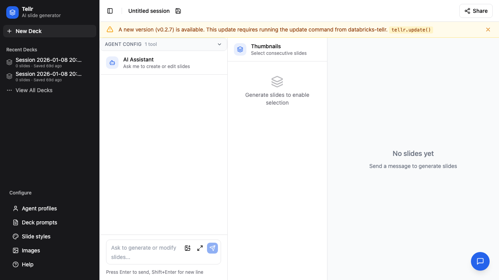
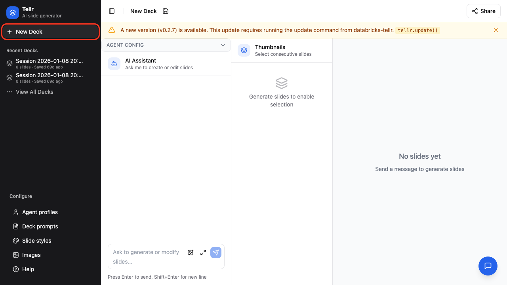
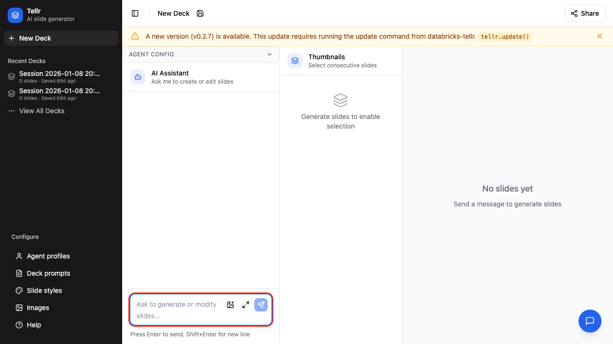
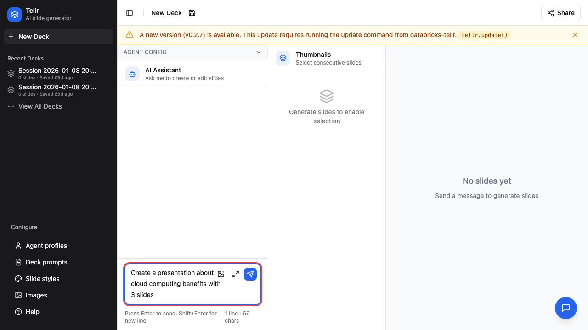
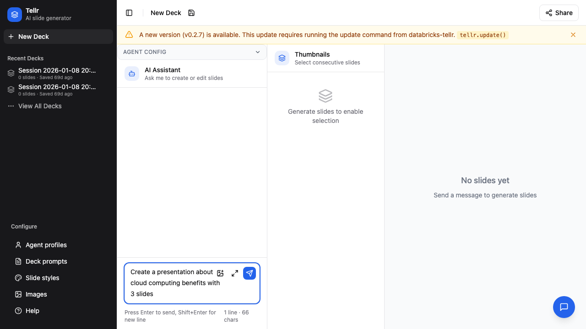

# Generating Slides

This guide walks you through creating AI-generated presentations using Databricks Tellr.

## Overview

The slide generation workflow allows you to:
- Create presentations from natural language prompts
- Pull live data from connected Genie rooms
- Iteratively refine slides through conversation
- Export to PowerPoint, PDF, or HTML

## Prerequisites

- Access to the Databricks Tellr application
- A Genie room with relevant data (optional, for data-driven slides)

## Step-by-Step Instructions

### Step 01: Open the App

Navigate to the application URL. You'll land directly on the slide generator in pre-session mode, ready to start creating.

### Step 02: Configure Tools (Optional)

The AgentConfigBar at the top shows your current tools (Genie agents, etc.). You can add data sources before or after generating slides. Without any Genie agents, the agent runs in prompt-only mode.

### Step 03: Enter Your Prompt

Click in the chat input area at the bottom of the screen.

### Step 04: Describe Your Presentation

Type a clear, specific prompt describing what you want:
- Topic and scope
- Number of slides (optional)
- Data to include (if using Genie)
- Any specific requirements

### Step 05: Send Your Request

Click the **Send** button or press Enter to start generation. A session is created automatically on your first message.

## Iterating on Your Slides

While your request runs, the chat shows what Tellr is doing — planning the deck, building and reviewing slides, fixing slides the review flags and reviewing the narrative — and slides appear in the right panel as they finish.

Refine slides through follow-up messages in the same session:

| Action | Example Prompt |
|--------|----------------|
| Edit slide contents | "Change title to 'Q4 Results'" |
| Add a slide | "Add a new slide about \{X\} after this one" |
| Regenerate all | "Regenerate all slides with more data" |

## Clearing the Chat

A long conversation can drift. To start the conversation over without losing your deck, click **Clear chat** at the top of the chat panel, on the right of the "AI Assistant" heading. Clear chat resets the whole conversation; to remove one exchange, see [Deleting a Message](#deleting-a-message).

A confirmation asks "Clear chat?" before anything happens. Confirm with **Clear chat**, or choose **Cancel** to leave everything as it is.

**What is kept:**
- Your slides
- The deck's Spec, if it has one (the **Spec** view beside **Slides**)
- Your save points
- The Graph Version the deck is pinned to (the "Pinned Graph Version" line above the chat). Clearing the chat does not move the deck to a newer version.

**What is deleted:** your conversation on this deck. The chat panel empties, and stays empty after you reload the page.

The assistant carries on from the Spec and the current slides, not from the old conversation. You can send "make slide 3 shorter" straight away. On a deck without a Spec, your slides stay, but the assistant has no Spec and no conversation to go on, so say what you want in full.

**When the button is available:**
- On any saved deck you can edit, whether or not it has a Spec. Viewers do not see it. See [Sharing & Permissions](./08-profile-sharing-permissions.md).
- It is greyed out while a reply is being generated, while you are previewing a save point, while the chat input is read-only, and when the chat is already empty. One exception: if a reply reports a problem part-way, or you click **Apply** or **Discuss** on a review suggestion while a reply is running, the button can become available before the reply has finished. Clearing then shows the "still running" message below, and nothing is cleared.
- It clears **your** conversation only. On a shared deck, each person's conversation is their own, and clearing yours never touches anyone else's.
- If something else is still running on the deck, such as a slide operation or a reply in another tab, you see "Something is still running on this deck. Wait for it to finish, then clear the chat." Your conversation is kept; try again once it finishes.

**Things to know:**
- **It cannot be undone.** The cleared messages do not come back to the chat.
- **Save points keep the chat they were saved with.** Previewing an older save point still shows the conversation as it was then. Restoring a save point does not bring a cleared conversation back.

## Deleting a Message

To remove one exchange from the conversation, hover over one of your messages in the chat panel and click the trash icon beside it. A confirmation asks "Delete this message?" before anything happens. Confirm with **Delete**, or choose **Cancel** to leave everything as it is.

**What is deleted:** your message **and the assistant's replies to it**, up to your next message. That includes any notices the assistant added to the exchange. The messages disappear from the chat panel, and the assistant no longer sees them. They stay gone after you reload the page.

**What is not undone:** the slides and the Spec are **not rolled back**. Whatever the deleted exchange changed stays as it is. If you want that change reversed, ask for it, for example "make slide 3 longer again". Your save points are not touched either.

**The deck's title is kept**, even when you delete your first message. Deleting the first message of a deck hides it instead of removing it, so the deck is still treated as started and its title is not regenerated.

**When the trash icon is available:**
- Only on **your own** messages, only on a saved deck, and only when you can edit the deck. Viewers do not see it. On a shared deck, each person's conversation is their own: you can delete in your conversation, never in the owner's or anyone else's. See [Sharing & Permissions](./08-profile-sharing-permissions.md).
- The trash icon appears only while you hover over the message (or tab to it with the keyboard). While a reply is being generated, while a clear or another delete is running, and while the chat is read-only, it appears greyed out and cannot be clicked. It is not shown at all while you preview a save point.
- One exception: if a reply reports a problem part-way, or you click **Apply** or **Discuss** on a review suggestion while a reply is running, the icon can become clickable before the reply has finished. A click then shows the "still running" message below, and nothing is deleted.
- A message you have just sent can be deleted as soon as its reply has finished. Until then it has no trash icon. If it still has none after the reply, reload the page.
- If something else is still running on the deck, such as a slide operation or a reply in another tab, you see "Something is still running on this deck. Wait for it to finish, then delete the message." Your conversation is kept; try again once it finishes. This can also happen in the moment right after a reply finishes.
- If the message is already gone, for example because you deleted it in another tab, you see "That message is no longer in this conversation. Reload the page to see the current conversation."

**Things to know:**
- **It cannot be undone.** The deleted messages do not come back to the chat, and no placeholder is left in their place.
- **Save points keep the chat they were saved with.** Previewing an older save point still shows an exchange you deleted later. Restoring a save point never brings a deleted exchange back to the chat.
- **Genie spaces keep their own history.** Questions the assistant already put to a Genie space stay in that space's own conversation. Deleting a message does not remove them.

## Navigating Slides

Click any thumbnail in the ribbon on the left to jump to that slide. You can also use the arrow buttons on the stage, or keyboard arrow keys when the viewer is focused. The current slide is always kept in view in the ribbon.

To refine a specific slide, navigate to it and describe the change in the chat panel — the AI will target the slide you are currently viewing.

## Returning to a Previous Session

To get back to a previous session, click **My Sessions** in the navigation bar. Any session with slides has a **Restore** button that loads it back into the editor.

## Reviewing the Deck Spec

Click **Spec** above the slide viewer to see the plan the agents work from.

It is read-only; click **Discuss** to change it in the chat.

Click **Export spec** to download it as a Markdown file, for review or sharing outside Tellr. The file is named after the title the agents gave the plan, which can differ from the deck name in the header. It holds everything in the Spec view, plus that title, each slide's type and data references, and the data the agents resolved: a summary, each figure with its source, and any gaps they recorded.

## Tips

- **Be specific**: Include topic, audience, and desired outcomes in your prompt
- **Use data queries**: Ask questions about your data, e.g., "Show top 10 customers by revenue"
- **Iterate**: Start simple and refine through follow-up messages
- **Check verification**: Click Verify on slides with data claims to validate accuracy
- **Share your work**: Use the **Share** button to copy a read-only link to your presentation

## Related Guides

- [Saving and Loading Configurations](./02-creating-profiles.md) - Save and reuse configuration snapshots
- [Advanced Configuration](./03-advanced-configuration.md) - Customize prompts and styles
