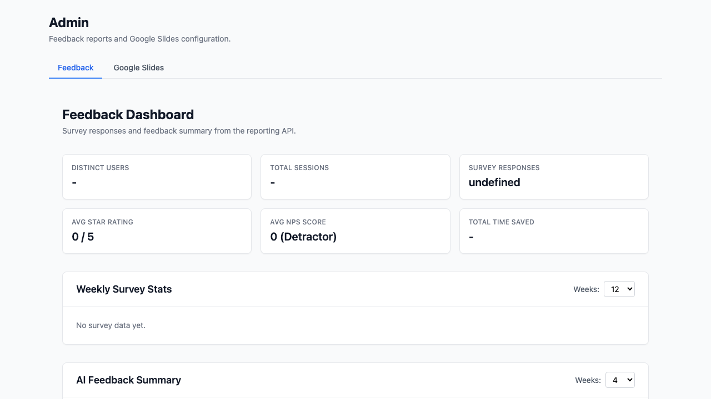
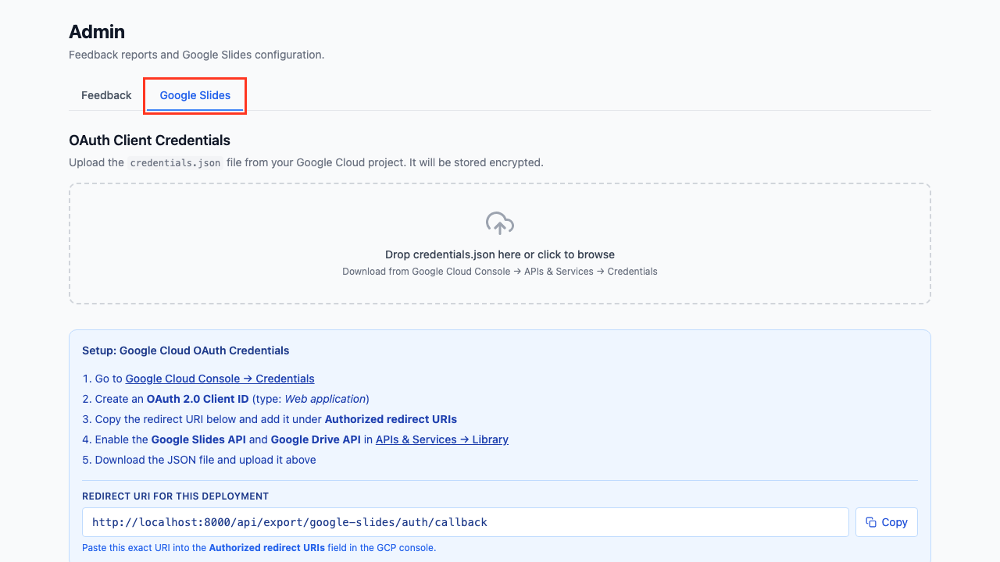
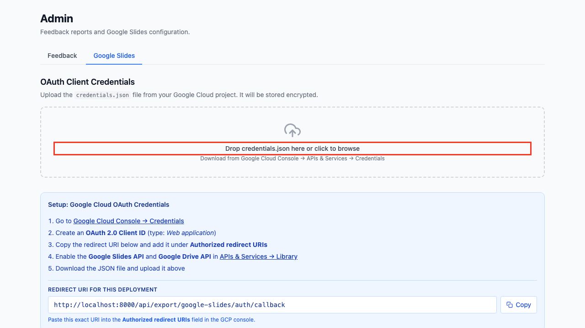
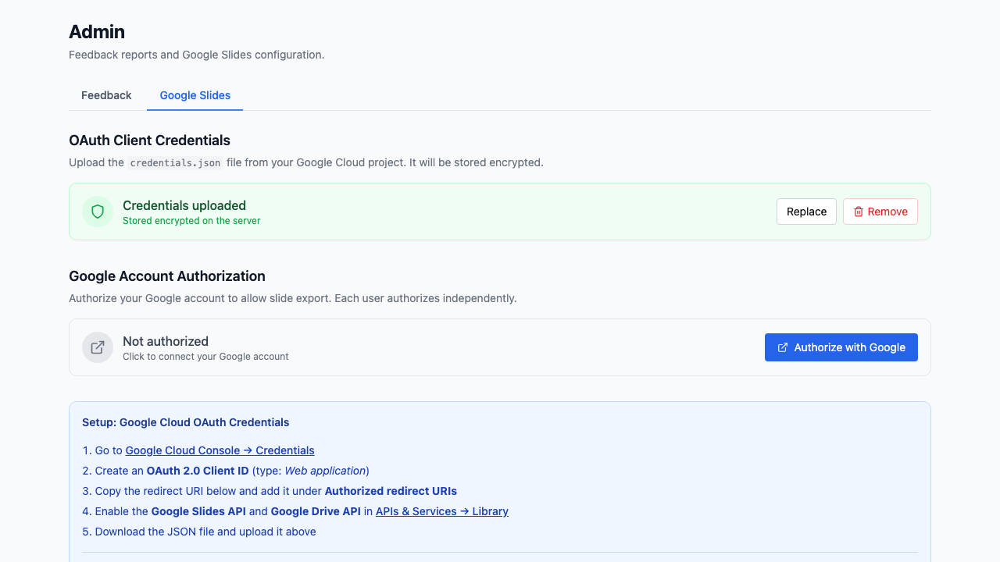
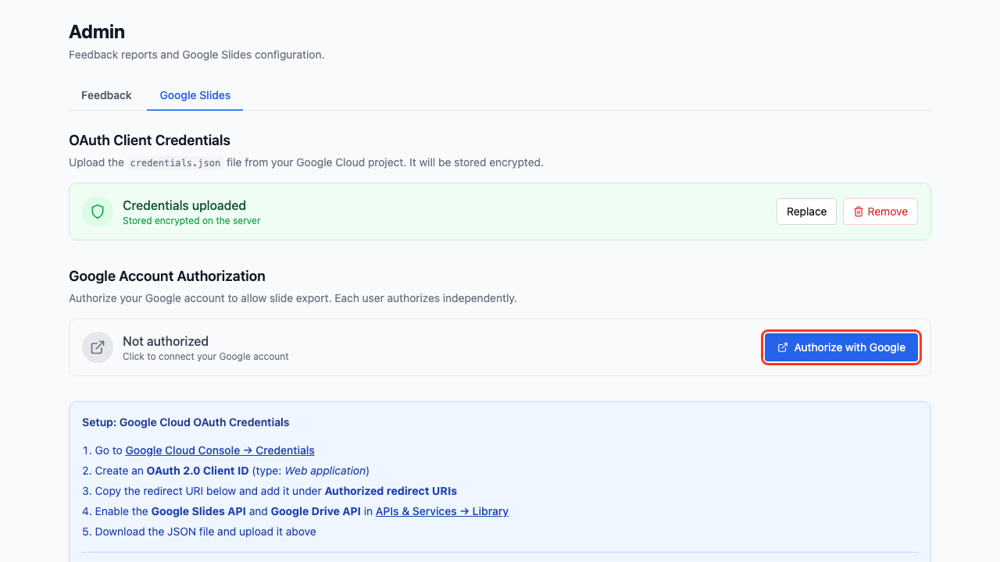
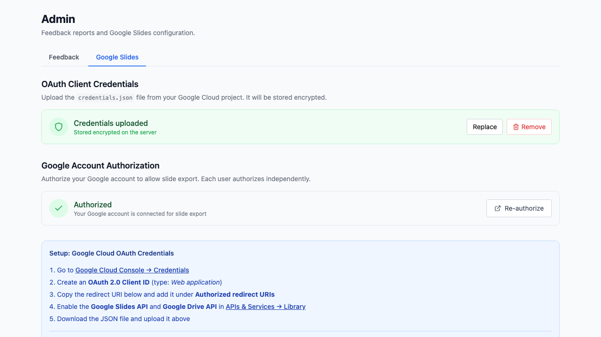
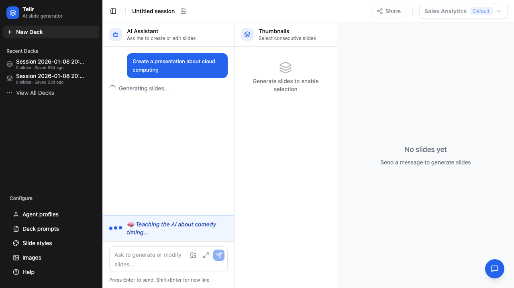
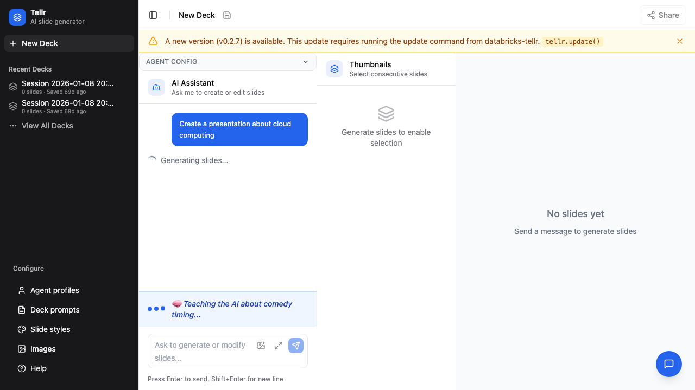

# Exporting to Google Slides

This guide covers how to set up Google Slides integration and export your AI-generated presentations to Google Slides.

## Overview

The Google Slides export creates an editable Google Slides presentation from your generated deck. Tellr renders each slide as you see it, writes the deck as a PowerPoint file made for Google Slides, and uploads it to your Google Drive, which converts it to a native presentation you can share and edit in Google Workspace.

## Prerequisites

- Access to the Databricks Tellr application
- A Google Cloud project with the Google Slides API and Google Drive API enabled
- Admin access to upload OAuth credentials (one-time setup)
- A generated slide deck to export

---

## Part 1: Admin Setup (One-Time)

An administrator must upload Google OAuth credentials before any user can export. This only needs to be done once for the entire application.

### Step 01: Open the Admin Page

Navigate to the `/admin` URL or click **Admin** in the navigation. The admin page has tabs for different settings.

### Step 02: Go to the Google Slides Tab

Click the **Google Slides** tab to upload app-wide OAuth client credentials. Users connect their own Google accounts under **Configure → Settings**.

### Step 03: Obtain OAuth Credentials

Before uploading, you need a `credentials.json` file from Google Cloud Console:

1. Go to [Google Cloud Console](https://console.cloud.google.com/)
2. Create a project (or select an existing one)
3. Enable the **Google Slides API** and **Google Drive API**
4. Go to **Credentials** and create an **OAuth 2.0 Client ID** (Desktop app)
5. Download the `credentials.json` file

### Step 04: Upload Credentials

Drag and drop the `credentials.json` file onto the upload area, or click to browse. The file is validated, encrypted, and stored in the database.

Once uploaded, the status indicator changes to confirm the credentials are configured.

---

## Part 2: Per-User Authorization

Each user must authorize once to link their Google account. Open **Configure → Settings** in the sidebar (not the Admin page). Tokens are stored per-user and auto-refresh. Use **Disconnect** on the same page to remove Tellr's stored token.

### Step 05: Authorize with Google

On Settings, click **Authorize with Google**. A popup opens with the Google OAuth consent screen.

### Step 06: Complete Authorization

After granting consent in the popup, the authorization status updates to confirm your account is linked. **Disconnect** removes the stored token without changing the admin-uploaded client credentials.

Authorization is independent of profiles — it applies to your user account across the entire application.

---

## Part 3: Exporting a Deck

### Step 07: Open the Export Menu

With slides generated in a session, click the **Export** button in the slide panel to open the export dropdown.

### Step 08: Select Google Slides

Click **Export to Google Slides** to start the export.

Tellr renders the deck and uploads it to Drive in one step. When complete, a link to the new presentation appears. Click it to open and edit in Google Slides.

---

## How the Export Works

1. The frontend sends the session ID to the export endpoint
2. The backend renders each slide in a server-side browser and reads it as it is laid out: text, shapes and tables become editable items where the browser drew them, and charts and graphics become pictures
3. It writes those slides as a PowerPoint file made for Google Slides
4. It uploads the file to your Drive with your Google authorization, and Drive converts it to a Google Slides presentation
5. If a slide cannot be rendered, the export still completes, and the message names the slides that are missing
6. If the server's exports are all busy, you see "Exports are busy right now. Please try again in a minute.

## Troubleshooting

| Problem | Cause | Solution |
|---------|-------|----------|
| "Not authorized" after previously working | Token expired or encryption key changed | Open **Settings** and click **Authorize with Google** again |
| Export reports missing slides | A slide could not be rendered | The other slides are in the presentation; check the slide's content and export again |
| "Exports are busy right now. Please try again in a minute." | The server is already running its exports | Wait a minute and export again |
| "Drive upload failed" | Google Drive refused or did not answer the upload | Export again; if it persists, check your Google authorization in **Settings** |
| "Credentials not configured" | Admin hasn't uploaded `credentials.json` | Ask an admin to upload credentials on the `/admin` page |
| App won't start in production | Encryption key missing or mis-configured | Verify the deployment used `tellr.update` / `deploy_local` (not the Databricks Apps UI button); check app logs for a key-resolution error |

### Production Encryption Key

The Fernet key for encrypting Google OAuth credentials lives in one of two places depending on how the app was deployed:

- **Secret-backed (opt-in):** The key is stored in a Databricks secret and injected automatically — no env var to manage manually. Deploy with `encryption_secret_scope` passed to `tellr.create()` / `tellr.update()`.
- **Lakebase-backed (default):** The key is stored in the `encryption_keys` table of the app's Lakebase database. Self-seeded on first use; no manual setup required.

In local development, a key is auto-generated and persisted to `.encryption_key` (gitignored).

## Tips

- **Export after finalising** — Export once you're satisfied with the slides: exporting the same session again replaces its earlier presentation in your Drive
- **Charts are pictures** — Charts are captured as high-resolution pictures; their HTML titles, legends and labels stay editable text
- **Slides are 16:9** — The exported presentation uses widescreen dimensions (13.333" x 7.5")
- **Edit freely in Google** — Text, shapes and tables are native Google Slides elements, so they are fully editable; a line of text keeps the line breaks you saw in Tellr

## Related Guides

- [Generating Slides](./01-generating-slides.md) — Create the slide deck before exporting
- [Advanced Configuration](./03-advanced-configuration.md) — Configure profiles and styles
